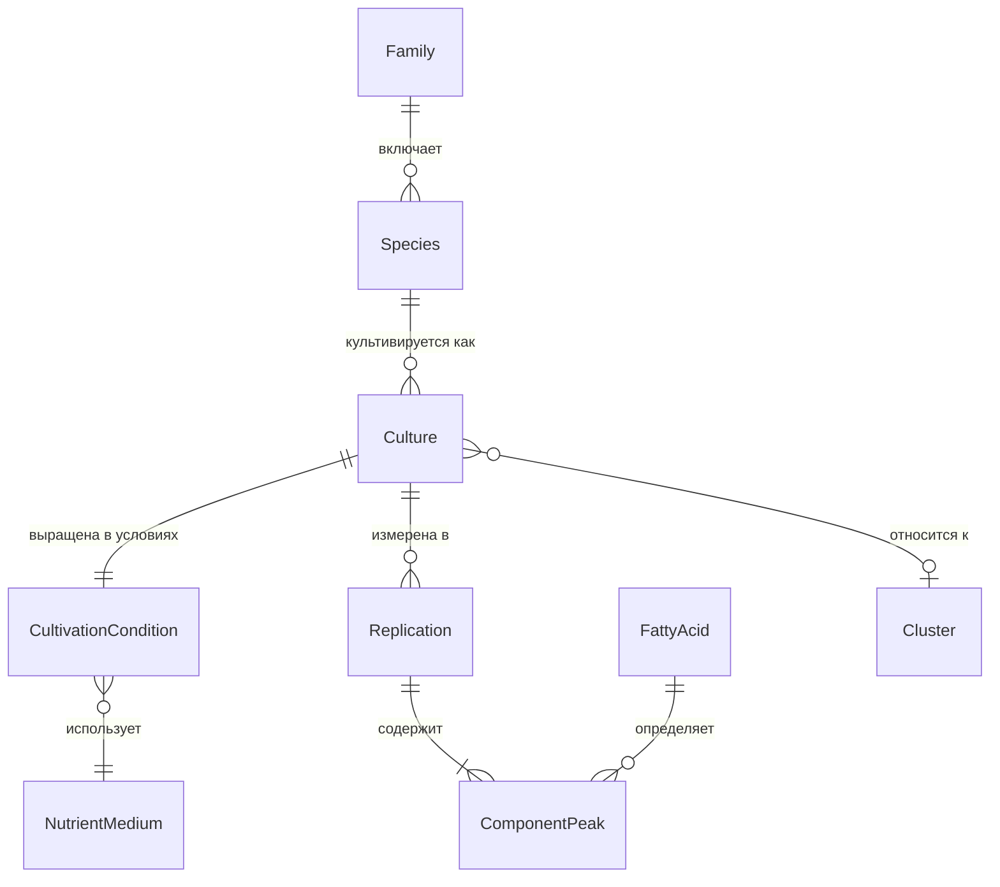

# CellCultures — дизайн проекта

## 0. Статус и границы документа

Документ описывает проект на основе двух источников:

1. рабочая книга `Скрининг_культур.xlsx` (10 листов) — предметная область, структура данных, формулы;
2. проектные решения по пресетам и виджету загрузки (формат пресета, индекс `index.ron`, workspace).

Исходный код приложения мне не передавался. Поэтому разделы про предметную область, данные, формулы, формат пресета и распространение пресетов — это описание фактов и принятых решений, а разделы, помеченные **«предложение»**, — рекомендации, которые нужно подтвердить. Всё, что относится к внутренностям приложения (панели, графики, состояние), здесь не описано; места, где это нужно дополнить, собраны в разделе 12.

---

## 1. Назначение

CellCultures — проект для хранения, просмотра и сравнения жирнокислотного состава культур клеток.

Исходный набор данных — скрининг культур растительных клеток: 70 записей о культурах, 32 вида, 17 семейств (сводка внутри книги называет 69 культур и 16 семейств, потому что семейство Plantaginaceae в неё не попало). Для каждой культуры определены:

* условия культивирования (питательная среда, ауксин, цитокинин, возраст культуры);
* относительное содержание основных жирных кислот (среднее ± стандартное отклонение по повторностям);
* содержание жирных кислот в сухой биомассе (мг/г);
* индекс ненасыщенности;
* принадлежность к кластеру по составу;
* для части культур — наличие и размер олеосом (липидных телец).

В данных пресетов встречаются и другие объекты, например микроводоросль *Chromochloris zofingiensis* (культура C-108), поэтому модель не должна быть привязана только к высшим растениям.

Результат работы проекта — набор пресетов (одна повторность измерения = один файл `ron`) в репозитории с данными и приложение с виджетом, которое загружает пресеты с GitHub и показывает их деревом.

---

## 2. Глоссарий

| Термин                | Значение                                                                                    | Имя в коде           |
| --------------------- | ------------------------------------------------------------------------------------------- | -------------------- |
| Культура              | Линия клеток в конкретных условиях культивирования. Одна запись в книге                     | `Culture`            |
| Вид                   | Полное латинское название, например `Panax ginseng`                                         | `species`            |
| Семейство             | Ботаническое семейство, например `Araliaceae`                                               | `family`             |
| Эксплант              | Ткань, из которой получена культура (лист, корень, семя и т. д.)                            | `Explant`            |
| Питательная среда     | Состав среды: MS, SH, B5, B5+MS (лист «Пит среда»)                                          | `NutrientMedium`     |
| Ауксин                | Регулятор роста, добавляемый в среду; их может быть несколько или не быть вовсе             | `Auxin`              |
| Цитокинин             | Регулятор роста; может отсутствовать                                                        | `Cytokinin`          |
| Возраст культуры      | Число лет с момента получения, на 2026 год                                                  | `culture_age_years`  |
| Повторность           | Независимое измерение одной культуры (1–5), со своей датой                                  | `Replication`        |
| ЖК                    | Жирные кислоты                                                                              | `FattyAcid`          |
| Основные ЖК           | 16:0, 18:0, 18:1Δ9, 18:2Δ9,12, 18:3Δ9,12,15                                                 | `MainFattyAcid`      |
| Прочие                | Остаток до 100 % после вычитания основных ЖК                                                | `other_fatty_acids`  |
| Внутренний стандарт   | Вещество известной массы (37,5 мкг), по площади пика которого считается абсолютная масса ЖК | `internal_standard`  |
| Индекс ненасыщенности | Среднее число двойных связей на молекулу ЖК (см. раздел 5)                                  | `unsaturation_index` |
| Кластер               | Группа культур со схожим жирнокислотным составом (6 кластеров в книге)                      | `Cluster`            |
| Пресет                | Файл `ron` с метаданными и данными одной повторности                                        | `Preset`             |
| Индекс                | Файл `index.ron` со всеми метаданными пресетов репозитория                                  | `Index`              |

Обозначения ЖК: `16:0` — число атомов углерода и число двойных связей, `Δ9` / `d9` — положение двойной связи. В книге встречаются обе записи (`18:1Δ9` в сводных таблицах, `18:1 d9` в сырых данных).

---

## 3. Исходные данные: рабочая книга

| Лист        | Содержание                                                                                                                                         | Роль        |
| ----------- | -------------------------------------------------------------------------------------------------------------------------------------------------- | ----------- |
| `Лист1`     | Итоговая таблица: пять основных ЖК и «Прочие», среднее ± SD, строки сгруппированы по семействам                                                    | производная |
| `Куль-ние`  | Условия культивирования: вид, среда, ауксин, цитокинин, возраст; справа сводка по семействам (культур, видов)                                      | первичная   |
| `Общ. табл` | Две копии итоговой таблицы: числовая и текстовая («23,7±0,89»), плюс индекс ненасыщенности                                                         | производная |
| `Культуры`  | Сырые данные: площади пиков по 25 компонентам для каждой повторности, внутренний стандарт, массы, обводнённость, дата                              | первичная   |
| `Cбор`      | Относительный состав по всем культурам: среднее и SD по повторностям рядом                                                                         | производная |
| `Масса`     | Содержание ЖК в сухой биомассе, мг/г, среднее ± SD, по культурам                                                                                   | производная |
| `Лист3`     | Те же значения содержания ЖК, отсортированные по возрастанию                                                                                       | производная |
| `Кластер`   | Шесть кластеров: состав кластера, среднее ± SD по основным ЖК, индекс ненасыщенности, разбивка по семейству, экспланту, среде, ауксину, цитокинину | производная |
| `Лист1 (2)` | Морфология: происхождение, олеосомы (да / нет / не смотрели), субъективные оценки количества и размера, масса тары                                 | первичная   |
| `Пит среда` | Состав сред MS, SH, B5, B5+MS в мг/л по группам: макросоли, микросоли, органические вещества; ссылки на публикации                                 | справочник  |

Первичные листы — `Культуры`, `Куль-ние`, `Лист1 (2)`, `Пит среда`. Всё остальное пересчитывается из них и в хранилище не нуждается (раздел 4, «что хранить»).

### 3.1. Сырые данные (`Культуры`)

На каждую культуру приходится блок из пяти столбцов (повторности 1–5). Строки:

* площади пиков 25 компонентов: `12:0`, `14:0`, `16:0`, `16:1 d7`, `16:1 d9`, `16:2 d9,12`, `18:0`, `18:1 d9`, `18:1 d11`, `18:2 d9,12`, `18:3 d9,12,15`, `20:0`, `22:0`, `24:0`, `26:0`, `27:0`, `28:0`, `29:0`, `30:0`, пять компонентов с префиксом `di` (`di16:0`, `di18:0`, `di20:0`, `di22:0`, `di22:2 d5,13`) и `Furan` (расшифровка `di`-компонентов в книге не приведена);
* `Сумма`, `Миноры`, `% прочих миноров`;
* `Стандарт (37,5 мкг)` — площадь пика внутреннего стандарта;
* `Навеска, г`, `m лотка, г`, `m л+сыр`, `m л+сух`, `Обводнённость`, `m сух навески, г`;
* `m ЖК, мг`, `C ЖК, мг/г сух`, среднее значение и стандартное отклонение;
* `Дата` — дата измерения повторности (серийный номер даты Excel).

В первой повторности каждой культуры внутренний стандарт отсутствует. Поэтому относительный состав считается по всем пяти повторностям, а содержание в мг/г — только по повторностям 2–5.

### 3.2. Условия культивирования (`Куль-ние`, `Лист1 (2)`)

* Питательные среды: `MS` (Мурасиге — Скуга), `SH` (Шенка — Хильдебрандта), `B5` (Гамборга), `B5+MS` (MS с витаминами B5).
* Ауксины, как они записаны в книге: `2,4-Д` (2,4-дихлорфеноксиуксусная кислота), `НУК` (нафтилуксусная кислота), `ИУК` (индолилуксусная кислота), `ИМК` (индолилмасляная кислота). Допускаются комбинации (`2,4-Д ; ИУК`, `2,4-Д, НУК`) и прочерк `-`, означающий отсутствие.
* Цитокинины: `Кин` (кинетин), `БАП` (бензиламинопурин) или `-`.
* Возраст культуры — столбец `В` в `Куль-ние`; расшифровка подтверждается листом `Лист1 (2)` («Возраст (лет, на 2026)»: для культуры 8 — 12, для 17 — 11, для 31 — 45, для 62 — 29).
* Эксплант кодируется в `Кластер` буквами `Л`, `П`, `ВЧ`, `С`, `Г`, `А`, `D1✝`. Подтверждённые соответствия: `Л` — лист, `С` — семя (Tribulus terrestris), `Г` — гипокотиль (Alhagi pseudalhagi), `А` — ариллус (Euonymus maximowiczianus), `ВЧ` — вегетативная часть. Для `П` (Glaucium flavum, «стручки») и `D1✝` (культура, полученная мутагенезом из штамма) расшифровка нужна от вас. Лист `Лист1 (2)` содержит более подробное «происхождение» текстом: лист, корень, стебель, семя, гипокотиль, проросток, черенок листа, стручки, мутагенез из штамма.

---

## 4. Логическая модель данных

Это логическая модель. Она не повторяет типы вашего крейта `Metadata` и описывает только то, что должно быть выразимо в метаданных пресета и в индексе.



### 4.1. Сущности

| Сущность               | Поля                                                                                                                                                        | Откуда в книге                                               |
| ---------------------- | ----------------------------------------------------------------------------------------------------------------------------------------------------------- | ------------------------------------------------------------ |
| `Family`               | `name`                                                                                                                                                      | заголовки «Семейство …»                                      |
| `Species`              | `genus`, `species` (полное название в одном поле, например `Chromochloris zofingiensis`)                                                                    | столбец «Вид»                                                |
| `Culture`              | `culture_name`, `species`, `explant`, `origin_note`, `culture_age_years`                                                                                    | столбцы «Культура», `Э`, `В`; «происхождение» из `Лист1 (2)` |
| `CultivationCondition` | `nutrient_medium`, `auxins` (список), `cytokinins` (список)                                                                                                 | столбцы `ПС`, `А`, `Ц`                                       |
| `Replication`          | `replication_number`, `date`, `sample_mass_grams`, `tray_mass_grams`, `tray_with_wet_mass_grams`, `tray_with_dry_mass_grams`, `internal_standard_peak_area` | лист `Культуры`                                              |
| `ComponentPeak`        | `fatty_acid`, `peak_area`                                                                                                                                   | лист `Культуры`                                              |
| `FattyAcid`            | `carbon_atoms`, `double_bonds`, `double_bond_positions`, `label`                                                                                            | подписи строк                                                |
| `Cluster`              | `cluster_number`, список культур                                                                                                                            | лист `Кластер`                                               |
| `OleosomeObservation`  | `present` (да / нет / не смотрели), `quantity_note`, `size_note`, `comment`                                                                                 | `Лист1 (2)`                                                  |

### 4.2. Что хранить, а что считать

| Хранить (первичное)                        | Считать (производное)                                 |
| ------------------------------------------ | ----------------------------------------------------- |
| площади пиков по повторностям              | относительный состав, среднее ± SD                    |
| площадь пика стандарта, массы, дата        | обводнённость, сухая масса навески, масса ЖК, мг/г    |
| условия культивирования, эксплант, возраст | индекс ненасыщенности                                 |
| наблюдения за олеосомами                   | «Прочие», сортировки, кластеры, таблицы по семействам |

Производные значения не пишутся в пресеты: так они не расходятся с первичными данными. Исключение — кэш в индексе, если он понадобится виджету (решение пока не принято, см. раздел 12).

---

## 5. Расчёты

Все формулы ниже проверены на данных книги.

```text
water_content        = 1 − (tray_with_dry_mass − tray_mass) / (tray_with_wet_mass − tray_mass)
dry_sample_mass      = sample_mass × (1 − water_content)                      # г
fatty_acid_mass      = total_peak_area / internal_standard_peak_area
                       × internal_standard_micrograms / 1000                  # мг, стандарт 37,5 мкг
fatty_acid_content   = fatty_acid_mass / dry_sample_mass                      # мг/г сухой массы
relative_content     = component_peak_area / total_peak_area                  # доля 0…1; в таблицах × 100, %
other_fatty_acids    = 100 − Σ(relative_content основных ЖК, %)
unsaturation_index   = Σ(relative_content_i, % × double_bonds_i) / 100        # по пяти основным ЖК
```

Проверочные значения:

* культура `6a`, повторность 2: `1 − (0,7672 − 0,6336) / (1,725 − 0,6336) = 0,8776`, масса ЖК 0,9203 мг, содержание 39,24 мг/г — совпадает с книгой;
* культура `VincDK`: `(8 × 1 + 51,1 × 2 + 5,9 × 3) / 100 = 1,279` — совпадает; `Pfil`: 0,673 — совпадает;
* среднее и стандартное отклонение — выборочное (делитель `n − 1`): для `6a` получается 2,995 мг/г, как в книге.

Свойства, которые важно сохранить в реализации:

* относительный состав усредняется по всем доступным повторностям (до 5), содержание в мг/г — только по повторностям с внутренним стандартом (до 4), поэтому `n` нужно хранить и показывать вместе со средним;
* индекс ненасыщенности считается только по пяти основным ЖК, и при большом значении «Прочие» (например, 46,6 % у `Pfil`) он занижен — это нужно показывать пользователю;
* «Прочие» в книге местами записаны текстом со сноской («46,6 (1)») — это значение нужно хранить числом, а сноску отдельно (раздел 12).

---

## 6. Пресет

Пресет — файл `ron` с метаданными и данными одной повторности.

```text
(
    meta: [ (name: "<ключ>", value: "<значение>"), ... ],
    data: ( bytes: ..., hash: ... ),
)
```

Это схема формата, а не пример с реальными значениями. `meta` — список пар «ключ — значение», `data` — байты кадра данных и его хеш.

### 6.1. Ключи метаданных

| Ключ                    | Значение                                                                       | Примечание                                                                                                                                  |
| ----------------------- | ------------------------------------------------------------------------------ | ------------------------------------------------------------------------------------------------------------------------------------------- |
| `Name`                  | отображаемое имя                                                               |                                                                                                                                             |
| `Author`                | автор                                                                          | может повторяться                                                                                                                           |
| `Standard`              | стандарт, по которому выполнено измерение                                      | может повторяться                                                                                                                           |
| `Date`                  | дата измерения повторности                                                     |                                                                                                                                             |
| `Index`, `Replication`  | идентификатор и номер повторности; в индексе это ключи `INDEX` и `REPLICATION` | `Version` раньше означал номер повторности и больше не используется как «последняя версия»; все повторности значимы, скрывать старые нельзя |
| `CultivationCondition`  | условия культивирования                                                        |                                                                                                                                             |
| `Lipids`                | `Total` или `Neutral`                                                          |                                                                                                                                             |
| `StereospecificNumbers` | стереоспецифические номера                                                     | необязательный                                                                                                                              |
| `DOI`                   | например `10.1002/ejlt.200700040`                                              | нет ключа — значит, DOI ещё не присвоен                                                                                                     |
| `Genus`, `Species`      | род и полное название вида                                                     | планируются; для `C-108` значение `Species` — `Chromochloris zofingiensis`                                                                  |

Принцип: **все метаданные лежат внутри файла пресета** в виде «ключ — значение» (DOI, URL, `Species` и т. д.) и целиком попадают в индекс. Имена файлов и родительские папки нужны только людям, которые сопровождают репозиторий. Файл `annotations.ron` не используется.

### 6.2. Метаданные пресета и рабочая книга (предложение)

| Столбец книги              | Ключ метаданных        |
| -------------------------- | ---------------------- |
| «Культура»                 | `Name`, `Index`        |
| «Вид»                      | `Genus`, `Species`     |
| `ПС`, `А`, `Ц`, `В`        | `CultivationCondition` |
| номер повторности          | `Replication`          |
| «Дата»                     | `Date`                 |
| «Стандарт (37,5 мкг)»      | `Standard`             |
| «DOI» среды из `Пит среда` | `DOI`                  |

---

## 7. Распространение пресетов

### 7.1. Схема


* CI в репозитории с данными проходит по всем `ron`-пресетам и генерирует `index.ron`.
* Виджет загружает индекс при первом открытии и строит дерево. `PRESETS.ron` с меню, зашитым через `include_str!`, больше не нужен: при росте базы он раздувался.
* Порядок записей в индексе (по пути) не меняется. Пользовательская сортировка делается в виджете внутри групп.
* Индекс не зависит от вашего крейта `Metadata`: метаданные хранятся как пары `name` / `value`. При несовместимости формата виджет откатывается к предыдущей версии индекса.

### 7.2. Генератор индекса (`index_cli`, бинарь `index`)

| Режим          | Назначение                                                                                                                               |
| -------------- | ---------------------------------------------------------------------------------------------------------------------------------------- |
| генерация      | обходит каталог и пишет `index.ron`                                                                                                      |
| `sort`         | обходит каталог и сортирует метаданные в самих файлах пресетов                                                                           |
| проверка полей | по конфигу проверяет, что у пресета не забыто нужное поле (например, `Species` у `C-108`); опционально подставляет или заменяет значение |

### 7.3. Виджет

* Дерево групп. Группировка и сортировка задаются двумя одинаковыми рядами меток (`Group by`, `Sort by`) с кнопкой `+`. Порядок меток меняется перетаскиванием (`egui_dnd`).
* Подпись пресета в дереве: `Name`, `Date`, `Index`, `Replication` без префиксов.
* Статус «загружено» определяется сверкой с кадрами приложения по хешу и метаданным. Кнопка «Download all (N)» скачивает только недостающие пресеты. В заголовке группы показывается (загружено / всего). Значки на заголовке группы не нужны; контекстное меню по правой кнопке мыши сохраняется.
* Размер значков задаётся настройкой `icon_size`.
* Структуры виджета выводят `Serialize` и `Deserialize` за фичей `serde`.
* Зависимость от `Shared` из виджета убрана.

---

## 8. Структура workspace

Плоская структура в `crates/`:

| Крейт          | Назначение                                                                                                                              |
| -------------- | --------------------------------------------------------------------------------------------------------------------------------------- |
| `frame`        | кадры данных: `HashedDataFrame` (байты и хеш), `HashedMetaDataFrame`, `IdentifiableFrame` и `IdentifiableFrames` (идентификатор и кадр) |
| `index`        | библиотека: формат `index.ron`, ключи `INDEX` и `REPLICATION`                                                                           |
| `index_cli`    | запускаемый генератор индекса, бинарь называется `index`                                                                                |
| `index_widget` | egui-виджет загрузки пресетов с GitHub                                                                                                  |

Используются крейты `bon` (билдеры) и `thiserror` (ошибки) там, где они уместны.

---

## 9. Качество и нормализация данных

Рабочая книга собиралась вручную, поэтому импорт не может опираться на точное совпадение строк. Найдено при разборе книги:

| Проблема                                          | Примеры                                                                                                                                                                                                                                                          |
| ------------------------------------------------- | ---------------------------------------------------------------------------------------------------------------------------------------------------------------------------------------------------------------------------------------------------------------- |
| Одна культура под разными именами в разных листах | `PgL-НУК-БАП` (`Лист1`) / `PgL1-НУК-БАП` (`Куль-ние`) / `Pgl1-НУК-БАП` (`Культуры`); `GP-62` / `G.p.-62` / `GP62`; `DM1` / `DM-05-K = ДМ1` / `DM-05 (1)`; `V.V.-161-62` / `V.V. №161 62 -hv`; `PV4` / `Pv4`; `MA-E-ДБН`, `MA-R-ДБН` / `Маак-E-ДБН`, `Маак-R-ДБН` |
| Кириллица и латиница в одном имени                | `MA-Р-ДБН` и `MA-С-ДБН` в `Куль-ние` содержат кириллические `Р` и `С` вместо латинских `R` и `S`; `Сlad` начинается с кириллической `С`; `МA-L-ДНК` — кириллическая `М` и латинская `A`; в заголовке `Cемейство Dioscoreaceae` латинская `C`                     |
| Опечатки в названиях семейств                     | `Fabacea` в `Лист1` и `Кластер`, `Fabaceae` в `Куль-ние`                                                                                                                                                                                                         |
| Культура есть не во всех листах                   | `PV4-ДНК` — есть условия, нет состава; `RAr-MS1` пуст в `Лист1`, но заполнен в `Общ. табл`                                                                                                                                                                       |
| Сводка не совпадает с данными                     | сводка в `Куль-ние`: 69 культур, 16 семейств; в таблице условий 70 записей, 17 семейств                                                                                                                                                                          |
| Числа записаны по-разному                         | десятичная точка в числах, запятая в текстовых копиях («23,7±0,89»), `0,1±0` и т. п.                                                                                                                                                                             |
| Число и текст в одной ячейке                      | «Прочие»: `46,6 (1)` вместо `46,6`                                                                                                                                                                                                                               |
| Нерегулярная нумерация повторностей               | у `62N` повторности 1, 2, 4, 5; у `Clad` — 1, 2, 3                                                                                                                                                                                                               |
| Похоже на ошибку ввода                            | у `6a` площадь `16:0` в повторностях 3 и 4 совпадает до всех знаков, при этом другие компоненты (например, `18:2`) различаются                                                                                                                                   |

Правила для импорта (**предложение**):

1. Идентификатор культуры нормализуется: приведение к одному алфавиту по таблице соответствий, удаление пробелов в начале и в конце, единый регистр там, где это безопасно.
2. Таблица соответствий «имя в листе → канонический идентификатор» хранится в репозитории и редактируется вручную; импорт падает с понятной ошибкой на неизвестном имени, а не создаёт новую культуру.
3. Числа читаются из ячеек в числовом виде; текстовые копии («23,7±0,89») при импорте игнорируются.
4. Сноски отделяются от значений.
5. Повторности нумеруются по значению, а не по позиции, пропуски допустимы.

---

## 10. Представления (предложение)

Приложение должно уметь воспроизводить то, что сейчас делается листами книги:

| Представление                                                                | Эквивалент в книге   |
| ---------------------------------------------------------------------------- | -------------------- |
| таблица состава по культурам, сгруппированная по семействам, со средним ± SD | `Лист1`, `Общ. табл` |
| содержание ЖК в сухой биомассе, мг/г, с сортировкой                          | `Масса`, `Лист3`     |
| кластеры и их средний состав                                                 | `Кластер`            |
| условия культивирования и сводка по семействам                               | `Куль-ние`           |
| справочник питательных сред со ссылками на публикации                        | `Пит среда`          |
| наблюдения за олеосомами                                                     | `Лист1 (2)`          |

Для кластеров в книге есть список культур и среднее ± SD по каждому кластеру, но способ кластеризации не указан (раздел 12).

---

## 11. Соглашения

* Документация — в формате `md`; форматы `doc` и `docx` не используются.
* Имена полные и понятные, без сокращений: `position`, а не `pos`; `window`, а не `w`. Столбцы книги `ПС`, `А`, `Ц`, `В`, `Э` в коде называются `nutrient_medium`, `auxins`, `cytokinins`, `culture_age_years`, `explant`.
* Комментарии в коде — на русском.
* Метаданные хранятся парами «ключ — значение» внутри файла пресета; зависимость формата индекса от собственного крейта `Metadata` не допускается.
* Порядок записей в индексе не меняется.

---

## 12. Открытые вопросы

1. **Приложение.** Код не передавался: опишите (или пришлите) основные экраны, состояние и графики, чтобы я добавил раздел про их устройство.
2. **Канонический идентификатор культуры.** Какие имена считать основными при разночтениях из раздела 9, и где хранить таблицу соответствий?
3. **Кластеризация.** Каким методом получены 6 кластеров (иерархическая, k-средних, другое), по каким признакам и когда они пересчитываются? В книге это не указано.
4. **Сноски у «Прочие».** Что означают номера (1)–(8) и пометка `(X)`? Расшифровку в книге я не нашёл.
5. **Эксплант.** Что означают `П` (Glaucium flavum) и `D1✝`, и нужно ли хранить перечисление или текст из «происхождение»?
6. **Расшифровка `di`-компонентов** (`di16:0`, `di18:0`, `di20:0`, `di22:0`, `di22:2 d5,13`) и `Furan`.
7. **Повторность 3 и 4 у `6a`:** совпадение площади `16:0` — это ошибка ввода или одно измерение, внесённое дважды?
8. **Кэш в индексе.** Нужно ли класть в `index.ron` производные значения (содержание в мг/г, индекс ненасыщенности) для сортировки в виджете, или сортировка идёт только по метаданным?
9. **Состав сред.** Нужно ли хранить состав сред (лист `Пит среда`) в репозитории данных или достаточно ссылки на публикацию в `DOI`?